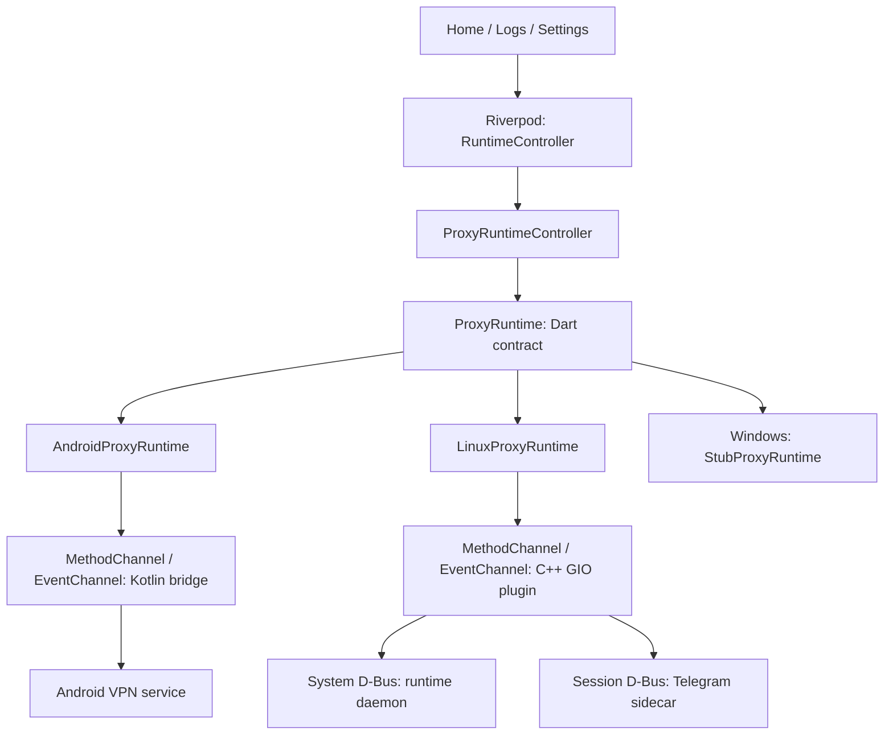

# Архитектура QNZapret

## Назначение и платформы

QNZapret — Flutter-приложение для управления локальным обходом DPI. Интерфейс
общий, а перехват и обработка трафика реализованы отдельно для каждой ОС.
Основной путь не требует удалённого VPN-сервера. Telegram использует отдельный
локальный MTProxy и внешние WebSocket/Cloudflare-маршруты.

| Платформа | Что есть в исходниках | Перехват |
| --- | --- | --- |
| Android | Kotlin VPN service, SOCKS5 strategy proxy, JNI TUN-to-SOCKS, Kotlin Telegram MTProxy | `VpnService`, без root |
| Linux | C++/GIO plugin, системный daemon, `nfqws2`, пользовательский Telegram sidecar, DEB/RPM packaging | nftables + NFQUEUE, с привилегированным daemon |
| Windows | Flutter runner и `StubProxyRuntime` | Сетевой backend отсутствует |

iOS, macOS и web не являются реализованными целевыми платформами проекта.
Текущие проблемы исходников и требования к проверкам — в
[руководстве разработчика](development.md).

## Слои управления

UI передаёт команды и отображает snapshot. Он не управляет сокетами,
firewall, JNI или системными процессами. Сетевой трафик не проходит через Dart.
Обратный путь — события snapshot/log через EventChannel и обновление Riverpod.

### Flutter: запуск, состояние и экраны

| Файл или каталог | Ответственность |
| --- | --- |
| [lib/main.dart](../lib/main.dart) | Инициализация Flutter, загрузка SharedPreferences, выбор runtime и overrides в ProviderScope |
| [lib/app/app.dart](../lib/app/app.dart) | MaterialApp, тема, палитра, scroll behavior |
| [lib/app/navigation/](../lib/app/navigation/) | AppShell: Home и Logs в PageView; Settings открывается отдельной страницей или диалогом |
| [lib/core/backend/](../lib/core/backend/) | Общие модели, платформенные адаптеры, фабрика runtime и контроллер команд |
| [lib/core/state/](../lib/core/state/) | Riverpod RuntimeController, состояние настроек, view models статусов и логов, package info |
| [lib/features/](../lib/features/) | Home: Start/Stop и Telegram setup; Logs: журнал, копирование, очистка, автопрокрутка; Settings: оформление и сведения о приложении |
| [lib/app/theme/](../lib/app/theme/) | Material 3, светлая/тёмная тема и шесть палитр |
| [lib/core/ui/](../lib/core/ui/) | Design tokens, фон, карточки, кнопки, status chips и иллюстрации |
| [lib/core/motion/](../lib/core/motion/) | Общие анимации, физика прокрутки, плавная desktop-прокрутка |
| [lib/core/persistence/](../lib/core/persistence/) | Provider SharedPreferences |

`ProxyRuntimeController` подписывается на события, хранит snapshot и launch
config, исключает одновременные команды, переводит исключения в
`ProxyRuntimeFailure`. После Start/Stop он дополнительно опрашивает snapshot,
пока переход не завершится: до 30 попыток с интервалом 200 мс.

Riverpod `RuntimeController` превращает это состояние в `RuntimeViewState`,
выполняет Android prepare перед запуском при необходимости и держит последние
240 записей журнала в памяти. Это не полная копия logcat/journald.
`runtime_view_models.dart` вычисляет подписи готовности и частичного сбоя.

SharedPreferences сохраняет тему, палитру и последнюю вкладку. Runtime snapshot
получается от backend заново; Telegram credentials хранят платформенные части.
Версия приложения читается через `package_info_plus`, исходная версия —
[pubspec.yaml](../pubspec.yaml). Настройки UI не являются редактором стратегий.

## Два разных пути трафика

**Android:** приложения → Android TUN → `hev-socks5-tunnel` → локальный Kotlin
SOCKS5 proxy → protected TCP/UDP sockets → сеть. Стратегия выбирается по порту,
протоколу и hostlist. Собственный пакет исключается из VPN; исходящие runtime
сокеты защищаются через `VpnService.protect(...)`. Подробности —
[Android](android.md).

**Linux:** выбранные пакеты IPv4/IPv6 → собственная таблица nftables
`inet qnzapret` → NFQUEUE 200 → `nfqws2` с Lua-стратегией → сетевой стек Linux.
Это пакетный backend с root daemon и сбросом UID worker. Android TUN и
локальный SOCKS5 в этом пути не используются. Подробности — [Linux](linux.md).

Hostlists включают bypass-действия. Для HTTP/TLS трафик вне списков проходит
обычно. QUIC-правило общего дефолтного профиля имеет пустой hostlist; Android
применяет его к распознанному QUIC Initial на UDP/443. Linux compiler добавляет
QUIC hostlists `list-google` и `list-user`. Общее имя профиля не делает Android
и Linux алгоритмически одинаковыми: Android TCP fake пропускает, Linux
компилирует профиль в собственную фиксированную стратегию `nfqws2`.

**Telegram:** клиент Telegram → локальный MTProxy, обычно `127.0.0.1:1443` →
платформенный compatibility backend → Telegram Web/DC или Cloudflare gateway.
Пользователь подтверждает настройку proxy в самом Telegram. Android реализует
transport на Kotlin; Linux использует Python core с отдельным адаптером.
Запущенный listener и успешный bridge — разные уровни готовности.

## Карта нативного кода и поставки

| Каталог | Состав |
| --- | --- |
| [android/app/src/main/kotlin/dev/qnzapret/](../android/app/src/main/kotlin/dev/qnzapret/) | Bridge, VPN lifecycle/store, TUN transport, SOCKS5, strategy engine, Telegram и диагностика |
| [android/app/src/main/jni/](../android/app/src/main/jni/) | NDK-конфигурация и git submodule `hev-socks5-tunnel` |
| [android/app/src/main/AndroidManifest.xml](../android/app/src/main/AndroidManifest.xml) | Разрешения, VPN service, Quick Settings tile, Activity настройки Telegram |
| [linux/runner/](../linux/runner/) | GTK/Flutter окно и асинхронный MethodChannel ↔ D-Bus plugin |
| [linux/runtime/](../linux/runtime/) | Системный daemon, compiler профиля/firewall, Telegram supervisor, проверка путей компонентов и state directory |
| [linux/components/](../linux/components/) | Python updater, Telegram adapter, CDN validation и их unit-тесты |
| [runtime/telegram/flowseal/proxy/](../runtime/telegram/flowseal/proxy/) | Поставляемый headless upstream Python core без GUI/tray |
| [runtime/assets/qnzapret/](../runtime/assets/qnzapret/) | Общие lists/payloads, Linux binary/Lua, Android Telegram seed, manifests, provenance и лицензии |
| [packaging/android/](../packaging/android/) | Генератор компактных hostlist-индексов |
| [packaging/linux/](../packaging/linux/) | Сборка bundle/DEB/RPM, systemd/D-Bus/Polkit, lifecycle scripts и проверки пакетов |
| [windows/](../windows/) | Стандартный C++ Flutter runner и ресурсы окна |
| [assets/branding/](../assets/branding/) | Логотип и исходники иконок интерфейса/launcher |
| [test/](../test/) | Dart-тесты, Android smoke/fixture, Linux netns и реальные сетевые сценарии |
| [.github/workflows/](../.github/workflows/) | Linux bundle/package и Windows release проверки |

`build/`, `.dart_tool/`, Flutter ephemeral и Gradle/NDK outputs — генерируемые
результаты. `.sources/` — локальная исследовательская зона, не production-код.

## Стратегии, assets и зависимости

Источник общего профиля — `StrategyProfile.defaultLightweight` в
[proxy_runtime.dart](../lib/core/backend/proxy_runtime.dart); Kotlin default
и Linux default wire поддерживаются отдельно. Правки дефолтов нужно сверять
между этими реализациями и тестами. Формат описан в
[контракте](runtime_bridge_contract.md).

Общие сетевые assets находятся в `runtime/assets`, а не в Flutter branding.
Gradle подключает этот каталог как Android assets и генерирует отдельные
компактные индексы. Linux CMake копирует runtime и Python core в bundle;
packaging размещает их в системных каталогах.

| Компонент | Зафиксированная поставка | Где записан источник |
| --- | --- | --- |
| Android `hev-socks5-tunnel` | `2.19.0`, submodule | `.gitmodules`, JNI `provenance.json`, gitlink |
| Linux zapret2 / `nfqws2` | `v1.0.5.2`, binary + Lua | runtime `provenance.json`, `manifest.sha256` |
| Linux tg-ws-proxy | `v1.11.2`, Python subset | runtime `provenance.json`, `runtime/telegram/flowseal/proxy/` |

Это версии встроенной поставки, а не последних upstream releases. Linux может
выбирать обновлённые поколения из системного cache. Dart-зависимости и их
разрешённые версии задают `pubspec.yaml` и `pubspec.lock`.

Лицензии и ограничения происхождения assets собраны в
[THIRD_PARTY_NOTICES.md](../runtime/assets/qnzapret/THIRD_PARTY_NOTICES.md).
Там отдельно отмечены неуточнённые права на старые hostlists/payloads и
отсутствие общей лицензии собственного кода. Приватные Telegram route domains,
relay credentials и smoke secrets не относятся к поставке репозитория.
